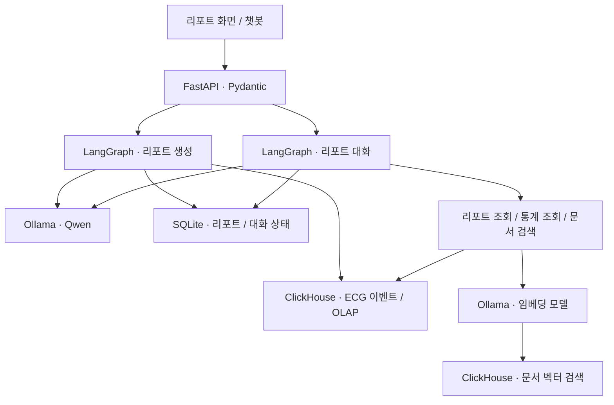

# ECG Report Agent

ECG 이벤트 데이터로 리포트를 만들고, 생성된 리포트에 대해 이어서 질문할 수 있는 백엔드 프로젝트입니다.

Python, FastAPI, LangGraph를 중심으로 구성합니다. Ollama에서 Qwen을 실행하고, ClickHouse는 이벤트 집계를 위한 OLAP 저장소와 문서 검색을 위한 벡터 저장소로 사용합니다.


## 프로젝트 개요

ECG 분석 결과에는 이벤트 종류, 발생 시각, 지속 시간 같은 정보가 쌓입니다. 이 데이터를 기간별로 정리해 리포트로 만들고, 리포트를 읽다가 생긴 질문까지 같은 흐름에서 처리하는 것이 목표입니다.

예를 들어 특정 기간의 부정맥 이벤트를 요약한 뒤, 사용자가 “심방세동은 몇 번 발생했어?”, “가장 오래 지속된 구간은?”, “리포트에 나온 AFIB가 무슨 뜻이야?”라고 물을 수 있습니다. 앞의 두 질문에는 데이터 조회가 필요하고, 마지막 질문에는 용어를 설명할 문서가 필요합니다.

이 차이를 기준으로 데이터 집계, 문서 검색, 답변 생성을 나눠 설계합니다. 발생 횟수와 지속 시간은 조회 결과로 확정하고, LLM은 질문을 해석하거나 결과를 읽기 쉬운 문장으로 정리하는 데 사용합니다.

입력은 분석 엔진이 이미 검출한 ECG 이벤트입니다. 이 프로젝트의 범위는 해당 결과의 조회, 요약, 설명이며, 원시 파형에서 부정맥을 검출하는 모델은 포함하지 않습니다. 개발에는 합성 이벤트와 공개 가능한 설명 문서를 사용합니다.

## 기술 구성

| 기술 | 역할 |
| --- | --- |
| Python | API, 데이터 조회, 리포트·챗봇 처리 로직 |
| FastAPI / Pydantic | REST API, 요청·응답 스키마, 입력값 검증 |
| LangGraph | 리포트 생성 단계, 대화 상태, 조회·검색 분기 관리 |
| Ollama | 로컬 모델 실행과 HTTP API 제공 |
| Qwen | 질문의 조건 추출, 리포트 코멘트 및 챗봇 답변 생성 |
| 임베딩 모델 | 문서와 질문을 검색용 벡터로 변환. Ollama에서 별도 실행 |
| ClickHouse | ECG 이벤트의 시계열 집계와 문서 임베딩 저장·유사도 검색 |
| SQLite | 초기 로컬 개발용 리포트 저장 및 대화 체크포인트 영속화 |

생성 모델과 임베딩 모델은 따로 설정합니다. Qwen의 구체적인 모델 태그와 크기, 임베딩 모델은 로컬 장비와 한국어 검색 결과를 확인한 뒤 고정할 예정입니다.

## 전체 구조



화면에서는 리포트 생성과 대화를 각각 API로 호출합니다. 백엔드에서는 두 흐름을 별도 그래프로 구성하고, ClickHouse 조회와 Ollama 호출 코드를 공통으로 사용합니다.

문서 등록은 별도 작업으로 처리합니다. 문서를 분할하고 임베딩을 생성한 뒤 ClickHouse에 저장해 두며, 질문이 들어오면 같은 임베딩 모델로 검색합니다.

### 리포트 생성

1. 대상 식별자, 조회 시작·종료 시각, 이벤트 종류를 검증합니다.
2. ClickHouse에서 해당 기간의 이벤트와 종류별 통계를 조회합니다.
3. 발생 횟수, 지속 시간, 주요 이벤트 구간을 리포트 입력으로 구성합니다.
4. Qwen이 집계 결과를 바탕으로 요약과 코멘트를 생성합니다.
5. 응답 형식과 원본 수치의 일치 여부를 확인합니다.
6. 조회 조건, 집계 결과, 생성 문장을 함께 저장하고 `report_id`를 반환합니다.

리포트에는 생성 시점의 결과를 보관합니다. 나중에 데이터가 추가되더라도 이미 만들어진 리포트의 수치가 바뀌지 않도록 합니다. 재생성한 결과는 새 리포트로 저장합니다.

데이터가 없을 때는 조회 결과가 없다는 상태를 반환합니다. 이를 정상 소견으로 바꾸어 표현하지 않습니다. LLM 호출이 실패하면 집계 결과는 유지하고 코멘트 생성 실패를 별도로 기록합니다.

### 리포트 생성 후 챗봇

대화는 `report_id`와 `thread_id`를 기준으로 이어집니다. 현재 리포트의 대상과 조회 기간을 기본 컨텍스트로 사용하고, 후속 질문에서 확정된 조건을 재사용합니다.

| 질문 예시 | 처리 방식 |
| --- | --- |
| “이 리포트를 짧게 요약해줘.” | 저장된 리포트와 집계 결과 사용 |
| “이 기간에 심방세동은 몇 번 있었어?” | 리포트 통계 확인, 필요한 경우 OLAP 조회 |
| “최근 7일 동안은 몇 번 있었어?” | 기간을 새로 계산해 ClickHouse 집계 |
| “AFIB가 무슨 뜻이야?” | 설명 문서를 벡터 검색해 답변 |
| “가장 오래 지속된 이벤트와 해당 용어를 설명해줘.” | 이벤트 조회 결과와 문서 검색 결과를 함께 사용 |

질문에서 조건을 추출할 때는 미리 정의한 스키마를 사용합니다. 예를 들어 “최근 7일간 심방세동 발생 횟수를 알려줘”는 다음과 같은 형태로 해석합니다.

```json
{
  "intent": "event_statistics",
  "event_type": "AFIB",
  "days": 7,
  "aggregation": "count"
}
```

Qwen에 허용된 이벤트 코드와 출력 스키마를 전달하고, 결과를 Pydantic으로 다시 검증합니다. 대상 식별자와 조회 권한은 서버에서 결정합니다. 기간 등 필수 조건이 불명확하면 사용자에게 재질문합니다.

“최근 7일”은 요청 시각과 서비스 시간대를 기준으로 시작·종료 시각을 계산합니다. 리포트의 원래 조회 기간과 다른 질문에는 실제로 조회한 기간도 답변에 표시합니다.

## LangGraph 구성

리포트는 정해진 순서로 실행하는 워크플로로 구성하고, 챗봇은 질문에 따라 필요한 조회와 검색을 선택하도록 구성합니다.

| 그래프 | 주요 노드 | State에 보관할 값 |
| --- | --- | --- |
| ReportGraph | `load_metrics`, `build_context`, `generate_report`, `validate_report`, `save_report` | 조회 조건, 이벤트 통계, 주요 구간, 생성 결과, 검증 결과, `report_id` |
| ChatGraph | `load_context`, `plan_query`, `validate_query`, `execute_tools`, `build_answer`, `validate_answer` | `report_id`, `thread_id`, 대화 이력, 질문 의도, 조회 조건, 도구 결과, 문서 출처 |

챗봇에서 사용할 도구는 세 가지로 시작합니다.

| 도구 | 역할 |
| --- | --- |
| `get_report` | 저장된 리포트와 생성 당시의 집계 결과 조회 |
| `query_ecg_events` | 대상·기간·이벤트 종류에 따른 통계와 주요 구간 조회 |
| `search_knowledge` | 용어와 리포트 항목을 설명할 문서 검색 |

초기에는 질문을 구조화한 뒤 코드에서 도구를 선택합니다. 이후 선택한 Qwen 모델의 Tool Calling을 검증하고, 모델이 반환한 도구 호출 요청을 `ToolNode`로 실행하는 방식으로 확장할 계획입니다. 일반 노드에서 Python 함수를 호출하는 것과 모델이 도구를 선택하는 흐름은 구분합니다.

각 도구는 허용된 조회만 수행합니다. LLM이 작성한 SQL을 그대로 실행하는 방식 대신, 검증된 조건을 정해진 쿼리에 바인딩합니다. 도구 호출 횟수와 모델 재시도 횟수에는 상한을 둡니다.

## ClickHouse: OLAP과 Vector RAG

### ECG 이벤트 집계

ClickHouse에는 이벤트 단위 데이터를 저장하고, 리포트와 챗봇에서 같은 조회 로직을 사용합니다.

- 대상·기간·이벤트 종류별 발생 횟수
- 이벤트 지속 시간과 최대 지속 구간
- 시간대별 발생 분포
- 리포트에 표시할 주요 이벤트 목록

이벤트 저장 구조는 `event_id`, `subject_id`, `event_type`, `started_at`, `ended_at`, `duration_ms`를 중심으로 잡습니다. 월 단위 파티션과 대상·발생 시각 정렬을 초기안으로 두고 실제 조회 패턴에 맞춰 조정합니다.

발생 횟수는 중복을 정리한 이벤트의 시작 시각을 기준으로 집계합니다. 조회 구간은 `[start_at, end_at)`으로 처리하고, 구간을 걸치는 이벤트의 지속 시간은 조회 기간과 겹치는 부분만 계산합니다. 시작 전에 발생해 구간 안에서 이어진 이벤트는 횟수에 추가하지 않고 지속 시간에만 반영합니다.

### 문서 검색과 RAG

벡터 검색 대상은 부정맥 용어, 이벤트 코드, 리포트 항목 등의 설명 문서입니다. 숫자를 묻는 질문은 정형 데이터 조회로 처리하고, 의미나 설명이 필요한 질문에 문서 검색을 붙입니다.

문서 등록 시 다음 값을 함께 저장합니다.

| 필드 | 내용 |
| --- | --- |
| `document_id`, `chunk_id` | 원문과 분할된 문단 식별자 |
| `content` | 검색 결과로 전달할 본문 |
| `source`, `document_version` | 문서 출처와 버전 |
| `embedding_model` | 사용한 임베딩 모델 식별자 |
| `embedding` | `Array(Float32)` 형태의 벡터 |

검색은 질문을 임베딩한 뒤 `cosineDistance`를 기준으로 가까운 문단을 가져오는 방식으로 시작합니다. 문서와 질문은 같은 모델·버전·차원을 사용하고, 모델을 바꾸면 문서를 다시 임베딩합니다.

초기에는 작은 문서 집합에서 정확 검색으로 결과를 확인합니다. 문서가 늘어나면 사용하는 ClickHouse 버전에 맞춰 HNSW 기반 `vector_similarity` 인덱스를 검토하고, 검색 품질과 응답 시간을 비교할 계획입니다.

최종 답변의 컨텍스트에는 다음 정보를 구분해서 넣습니다.

- 현재 리포트와 생성 당시의 집계 결과
- 질문에 따라 추가 조회한 ECG 이벤트·통계
- 벡터 검색으로 찾은 설명 문서와 출처
- 현재 질문 및 필요한 이전 대화

수치의 근거는 조회 결과에, 설명의 근거는 검색 문서에 둡니다. 답변에는 참조한 문서 식별자와 출처를 함께 반환하고, 검색 결과가 부족하면 근거가 부족하다고 표시합니다. 이전에 생성한 요약 문장을 새로운 사실의 근거로 재사용하지 않습니다.

## 디렉터리 구성안

초기에는 한 서비스 안에서 시작하고, HTTP 처리, 그래프, 데이터 접근 코드를 나눕니다.

| 경로 | 내용 |
| --- | --- |
| `app/main.py` | FastAPI 생성과 라우터 등록 |
| `app/api/reports.py`, `app/api/chat.py` | 리포트·챗봇 API |
| `app/schemas/` | 요청, 응답, 조회 조건, 모델 출력 스키마 |
| `app/graphs/report.py`, `app/graphs/chat.py` | 그래프와 분기 정의 |
| `app/graphs/state.py`, `app/graphs/nodes/` | 그래프 상태와 단계별 처리 |
| `app/tools/` | 리포트 조회, 이벤트 조회, 문서 검색 도구 |
| `app/repositories/` | ClickHouse 쿼리와 리포트 저장소 접근 |
| `app/retrieval/` | 문서 분할, 임베딩, 검색 결과 구성 |
| `app/llm/` | Ollama 클라이언트, 생성·임베딩 모델 설정 |
| `app/prompts/` | 리포트, 조건 추출, 답변 생성 프롬프트 |
| `app/core/` | 환경 설정, 로깅, 공통 오류 처리 |
| `sql/` | ClickHouse 테이블 DDL과 조회 예시 |
| `scripts/` | 합성 이벤트 적재와 문서 인덱싱 |
| `tests/` | 집계, 입력 검증, 그래프 분기, 응답 검증 |

라우터는 요청과 응답 처리를 맡고, 조회·저장 코드는 Repository에서 관리합니다. LangGraph 노드는 이 기능들을 호출하고 State를 갱신합니다. 대화 체크포인트와 리포트는 별도로 저장해, 특정 대화를 삭제해도 리포트 자체는 유지되도록 구성합니다.

### API 초안

| Method | Path | 용도 |
| --- | --- | --- |
| `POST` | `/reports` | 대상과 기간을 받아 리포트 생성 |
| `GET` | `/reports/{report_id}` | 저장된 리포트와 조회 조건 확인 |
| `POST` | `/reports/{report_id}/chat` | 리포트를 기준으로 질문. `thread_id`가 없으면 새 대화 생성 |
| `GET` | `/threads/{thread_id}/messages` | 해당 대화의 메시지 이력 조회 |

리포트에는 `report_id`, `subject_id`, `period`, `metrics`, `summary`, `generated_at`을 포함합니다. 재현을 위해 생성 모델과 프롬프트 버전도 저장합니다. 챗봇 응답에는 `thread_id`, `answer`, `query_period`, `sources`를 포함합니다.

서버는 리포트, 대화, 대상 식별자의 연결을 검증하고 모든 조회에 같은 접근 범위를 적용합니다. 리포트 생성은 작은 범위의 동기 요청부터 구현하고, 처리 시간이 길어지면 작업 ID 기반 비동기 방식으로 분리할 예정입니다.

## 구현 순서

- [ ] FastAPI와 Pydantic으로 리포트 요청·응답 정의
- [ ] 합성 ECG 이벤트 적재 및 ClickHouse 집계
- [ ] Ollama / Qwen 연결과 리포트 생성 그래프
- [ ] 리포트 저장 및 리포트 기반 후속 질문
- [ ] 문서 분할, 임베딩, ClickHouse 벡터 검색
- [ ] 통계 조회와 문서 검색을 연결한 챗봇 그래프
- [ ] 대화 체크포인트, 실패 처리, 수치·출처 검증
- [ ] 실행 환경과 샘플 요청 정리

먼저 같은 이벤트 데이터에서 같은 집계 결과가 나오는지 확인하고, 그 위에 문장 생성과 검색을 붙이려 합니다. 검증은 중복 이벤트, 조회 경계, 빈 데이터, 잘못된 모델 출력, 리포트와 다른 기간의 후속 질문을 중심으로 진행합니다.

실행 방법은 애플리케이션 코드와 의존성 구성이 추가되는 시점에 함께 작성할 예정입니다.

## 참고

- [LangGraph](https://docs.langchain.com/oss/python/langgraph/overview)
- [Ollama Structured Outputs](https://docs.ollama.com/capabilities/structured-outputs)
- [Ollama Embeddings API](https://docs.ollama.com/api/embed)
- [ClickHouse Vector Search](https://clickhouse.com/docs/reference/engines/table-engines/mergetree-family/annindexes)
